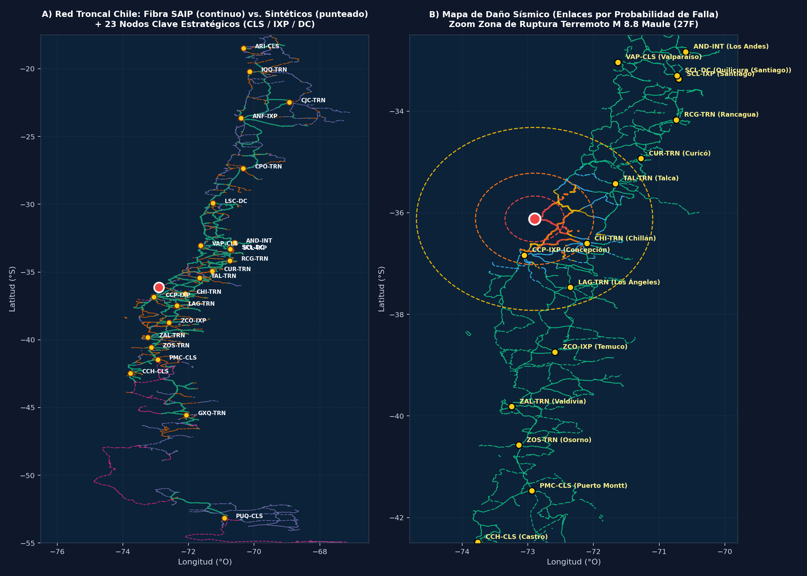

# Punto 10: Repositorio Unificado con `main.py` y Visualización en Leaflet

## 1. Ejecución Completa con un Solo Comando (`python main.py`)
Desde un clon limpio del repositorio, tras instalar las dependencias listadas en [requirements.txt](../requirements.txt):

```bash
pip install -r requirements.txt
python main.py
```

El comando `python main.py` (con Docker Desktop activo) ejecuta automáticamente todo el flujo de principio a fin:
1. **Verificación y Construcción de Datos**: Si los GeoJSON, topología o `main.sql` no existen, ejecuta automáticamente `build_project_data.py` sobre `info/Respuesta_T5610` e `info/terremotos.json`.
2. **Carga de la Base de Datos en Docker (`main.sql`)**: Levanta el contenedor `ruteo_chile_db` (`pgrouting/pgrouting:latest`) mediante `docker compose up -d` y carga [main.sql](../main.sql) en PostgreSQL + PostGIS + pgRouting.
3. **Impresión en Consola de Resultados**: Muestra en la terminal el resumen de infraestructura, enlaces sintéticos vs. originales, el ATTR en operación (antes) y el nuevo ATTR post-terremoto 8.8 (después), más los enlaces más y menos afectados.
4. **Levantamiento del Servidor Web con Leaflet**: Inicia la aplicación interactiva en **`http://127.0.0.1:8000`**.

---

## 2. Captura del Mapa con Nodos Clave, Enlaces Originales vs. Sintéticos y Daño del Terremoto



### Elementos Distinguidos en el Mapa Leaflet (`http://127.0.0.1:8000`):
- **Enlaces de Fibra Óptica Originales SAIP (`es_sintetico = false`, 1.915 tramos, 10.316,0 km)**: Representados con **línea continua sólida**.
- **Enlaces Complementarios / Sintéticos (`es_sintetico = true`, 2.582 tramos, 17.207,1 km: postación eléctrica, camino sin postación y ferry)**: Representados y distinguidos con **trazo punteado** (activable/desactivable desde el panel lateral) y etiqueta explícita en el popup.
- **23 Nodos Clave Estratégicos (`CLS / IXP / PIT / Data Centers / Troncales`)**: Marcadores amarillos destacados con etiqueta permanente de su código (`ARI-CLS`, `VAP-CLS`, `SCL-IXP`, `SCL-DC`, `CCP-IXP`, `ZCO-IXP`, `PMC-CLS`, `PUQ-CLS`, etc.) y popup con su rol (`Genera / Intercambia / Recibe`), fuente bibliográfica y pérdida de conectividad post-sismo.
- **367 Nodos Clave Topológicos (`cnt >= 3`)**: Marcadores celestes con su grado nodal e ID de vértice en `red_troncal_vertices_pgr`.
- **Epicentro M 8.8 (`-36.122°, -72.898°`) y Daño del Terremoto**: Marcador epicentral rojo con anillos de atenuación a $50\text{ km}$, $100\text{ km}$ y $200\text{ km}$, modo de coloreado por probabilidad de falla ($p_e$) y simulador interactivo de **Monte Carlo en vivo** y **Corte por Umbral ($\tau$)**.
