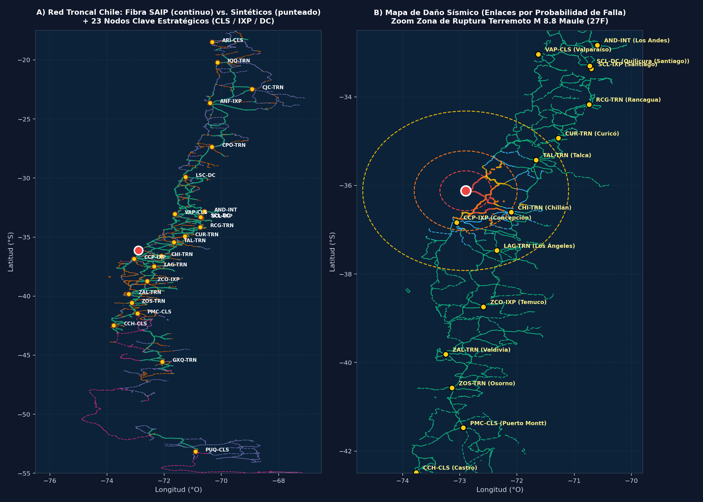

# Estudio de Resiliencia de la Infraestructura de Internet Chilena frente al Terremoto M 8.8 del Maule (27F 2010)

Repositorio e informe técnico sobre la **Red Troncal de Telecomunicaciones de Chile** (*Proyecto Yafún*, solicitud de transparencia SUBTEL `SAIP AN002T0005610` / `Respuesta_T5610`) y el análisis del impacto probabilístico del **Terremoto $M_w = 8,8$ del Maule (27-02-2010, USGS `official20100227063411530_30`)** mediante PostgreSQL/PostGIS/pgRouting, simulación de Monte Carlo y visualización interactiva en Leaflet.

---

## Ejecución en Un Solo Comando

Desde un clon limpio del repositorio:

```bash
# 1. Instalar dependencias declaradas
pip install -r requirements.txt

# 2. Ejecutar todo el flujo con un solo comando (BD main.sql, topología, probabilidades, ATTR antes/después y mapa Leaflet)
python main.py
```

Al ejecutar `python main.py` (con Docker Desktop abierto), el programa:
1. Construye o verifica la topología (`pgr_createTopology`), los nodos clave, las probabilidades de falla sísmica y el archivo [main.sql](./main.sql).
2. Levanta automáticamente el contenedor Docker de PostgreSQL/PostGIS/pgRouting (`docker-compose.yml`) y carga `main.sql`.
3. Imprime en consola los resultados de **ATTR Antes y Después**, enlaces más y menos afectados y el desglose de conectividad.
4. Levanta el visor cartográfico interactivo **Leaflet** en **`http://127.0.0.1:8000`**.

*(Opcional)* Para ejecutar únicamente el flujo y ver el reporte en consola sin abrir el servidor web:
```bash
python main.py --report-only
```

### Librerías Declaradas en `requirements.txt` y su Rol
| Librería | Uso y Justificación Técnica en el Proyecto |
| :--- | :--- |
| **`numpy`** | Generador pseudoaleatorio vectorizado (`default_rng(20100227)`) para las $N=500$ simulaciones de Monte Carlo y cálculo de percentiles y desviación estándar del ATTR. |
| **`scipy`** | Evaluación exacta de la distribución normal estándar acumulada $\Phi(\cdot)$ (`scipy.stats.norm.cdf`) en las curvas de fragilidad sísmica lognormal. |
| **`fastapi`** | Framework backend REST que expone los endpoints GeoJSON (`/api/red`, `/api/nodos-clave`, `/api/sismo`, `/api/attr`, `/api/simular`) para el visor Leaflet. |
| **`uvicorn`** | Servidor ASGI de alto rendimiento que aloja la aplicación web interactiva en `http://127.0.0.1:8000`. |
| **`pydantic`** | Validación de parámetros de simulación interactiva (modo Monte Carlo vs. umbral de corte $\tau$). |
| **`matplotlib`** | Generación automatizada de la captura cartográfica estática de alta resolución (`10_aplicacion_web/captura_mapa_leaflet.png`). |

---

## Arquitectura del Proyecto y Justificación Metodológica

El proyecto se organiza de manera modular en diez directorios secuenciales (`01_infraestructura/` a `10_aplicacion_web/`) junto con los archivos maestros en la raíz ([main.sql](./main.sql), [main.py](./main.py), [requirements.txt](./requirements.txt) y [docker-compose.yml](./docker-compose.yml)), separando claramente la ingestión cartográfica, la construcción topológica, el modelamiento sísmico y la capa de visualización interactiva:

### 1. Infraestructura y Nodos Clave ([01_infraestructura/](./01_infraestructura/README.md) · [02_nodos_clave/](./02_nodos_clave/README.md))
La capa de infraestructura integra las cuatro capas lineales de `info/Respuesta_T5610` (`4.497` tramos, `27.523,1 km`). Sobre esta red se identifican y listan los **23 Nodos Clave Estratégicos de Chile** (aterrizajes de cables submarinos CLS, Puntos de Intercambio de Tráfico IXP/PIT, clústeres de Data Centers y nodos troncales regionales) con sus coordenadas, rol funcional (`Genera / Intercambia / Recibe`), fuente bibliográfica (*SUBTEL, NIC Chile Proyecto Yafún, PIT Chile, TeleGeography*) e identificador de vértice exacto en la topología, complementados con los **367 nodos clave topológicos (`cnt >= 3`)** generados por `pgr_analyzeGraph` (ver [identificar_nodos_clave.py](./02_nodos_clave/identificar_nodos_clave.py)).

### 2. Construcción de Topología y Tratamiento de Enlaces Sintéticos ([03_topologia/](./03_topologia/README.md))
La topología de grafo se construye en PostGIS/pgRouting ejecutando `pgr_createTopology` con tolerancia de `0.0001°` ($\approx 11,1\text{ m}$ en WGS84) sobre la tabla `red_troncal` ([03_crear_topologia.sql](./03_topologia/03_crear_topologia.sql)), inicializando la probabilidad de falla en `0.0` por defecto. Se revisa la conectividad resultante (`4.556` vértices en `138` componentes conexas) y se declara explícitamente la limitación del archivo SAIP: la capa de fibra óptica detectada cuenta con **10.316,0 km** frente a los **27.523,1 km ($\approx 28.000\text{ km}$)** del Estudio Yafún; por ello, los **2.582 tramos complementarios** de postación eléctrica, caminos sin postación y trayectos en ferry se marcan explícitamente como **sintéticos (`es_sintetico = TRUE`)** y se justifican como enlaces de continuidad estructural.

### 3. Cálculo del ATTR en Operación Normal ([04_attr_operacion/](./04_attr_operacion/README.md))
El cálculo de confiabilidad ([calcular_attr_operacion.py](./04_attr_operacion/calcular_attr_operacion.py)) implementa la definición formal del **ATTR** según el paper de **Boettcher, Prieto, Restrepo & Pezoa (2018, Ec. 8, p. 2340)** y **Rai & Agrawal (1990)**, operando sobre la topología de la base de datos y las probabilidades de falla de cada enlace, con justificación estadística de $N=500$ iteraciones de Monte Carlo ($\text{SE} < 0,0045$). En operación normal (`prob_falla = 0`), el módulo reporta $\text{ATTR} = 0,142292$ para los 23 nodos estratégicos (frente a $0,027668$ usando solo fibra SAIP sin enlaces sintéticos) y $\text{ATTR} = 1,000000$ en el corredor troncal Centro-Sur conectado, detallando exactamente qué nodos clave conforman cada una de las **9 subredes desconectadas** en los shapefiles públicos.

### 4. Evento Sísmico M 8.8, Modelo de Falla y Archivo `main.sql` ([05_terremoto_geojson/](./05_terremoto_geojson/README.md) · [06_modelo_probabilistico/](./06_modelo_probabilistico/README.md) · [07_probabilidades_enlaces/](./07_probabilidades_enlaces/README.md) · [main.sql](./main.sql))
El evento del 27 de febrero de 2010 se incorpora en formato GeoJSON oficial del **USGS** (ID `official20100227063411530_30` y consulta FDSN) en [terremoto_8_8_maule.geojson](./05_terremoto_geojson/terremoto_8_8_maule.geojson) y se carga en la tabla PostGIS `sismo_88`. El modelo probabilístico ([modelo_probabilistico.py](./06_modelo_probabilistico/modelo_probabilistico.py)) acopla la ley de atenuación de PGA de **Fukushima & Tanaka (1990) / Contreras & Boroschek (2012)** con curvas de fragilidad lognormal (**FEMA HAZUS-MH; Esposito et al., 2015; Neumayer & Modiano, 2011**), documentando el origen bibliográfico de cada parámetro y su adaptación física a fibra óptica soterrada, postación aérea, caminos y ferrys. El cálculo espacial ([calcular_probabilidades_enlaces.py](./07_probabilidades_enlaces/calcular_probabilidades_enlaces.py)) proyecta las distancias en metros (`EPSG:32719` / `geography`), actualiza la base de datos y reporta los **10 enlaces más afectados** ($p_{\max} = 0,9004$) y los **10 menos afectados** ($p_{\min} = 0,000000$). Todo el esquema, la infraestructura, los nodos clave, el sismo y las probabilidades de los 4.497 enlaces quedan autocontenidos en [main.sql](./main.sql), listo para cargar directamente en una base de datos vacía.

### 5. Evaluación Post-Terremoto y Contraste Histórico con el 27F ([09_attr_post_terremoto/](./09_attr_post_terremoto/README.md))
El módulo post-sismo ([calcular_attr_post_sismo.py](./09_attr_post_terremoto/calcular_attr_post_sismo.py)) calcula el nuevo ATTR tras el terremoto M 8.8 y lo compara con el previo en diferencia absoluta y porcentaje, identificando los enlaces y nodos estratégicos más golpeados (Curicó, Talca, Temuco, Valdivia, Concepción, Chillán y Los Ángeles). Los resultados se contrastan con lo documentado históricamente en el 27F (**Kwasinski, 2010; SUBTEL, 2010; Cowie/Renesys, 2010; Astroza et al., 2012**) y se discuten explícitamente las limitaciones del modelo (fuente puntual vs. falla finita, ausencia de $V_{s30}$, dependencia energética y brechas urbanas SAIP).

### 6. Orquestación en Un Solo Comando y Visor Leaflet ([main.py](./main.py) · [10_aplicacion_web/](./10_aplicacion_web/README.md))
La arquitectura se integra en [main.py](./main.py), [requirements.txt](./requirements.txt) y [docker-compose.yml](./docker-compose.yml), permitiendo ejecutar todo el flujo con un único comando (`python main.py`) y obtener resultados idénticos a los del informe. La interfaz cartográfica en Leaflet ([10_aplicacion_web/index.html](./10_aplicacion_web/index.html)) despliega los nodos clave, los enlaces coloreados por tipo o por probabilidad de falla sísmica, el epicentro con anillos de atenuación y **distingue visualmente los enlaces sintéticos con trazo punteado** frente a la fibra óptica original SAIP en trazo continuo.

---

## Síntesis Ejecutiva de Resultados

### 1. Limitación SAIP y Distinción de Enlaces Sintéticos
- **Fibra Óptica Original SAIP (`fibra_optica_detectada.shp`, `es_sintetico = FALSE`)**: $1.915$ tramos con **$10.316,0\text{ km}$**.
- **Enlaces Complementarios / Sintéticos (`es_sintetico = TRUE`)**: $2.582$ tramos con **$17.207,1\text{ km}$** (`postacion_electrica`: $1.213$ tramos / $6.711,6\text{ km}$; `camino_sin_postacion`: $1.165$ tramos / $8.108,4\text{ km}$; `trayecto_en_ferry`: $204$ tramos / $2.387,1\text{ km}$), agregados y justificados para completar los **$27.523,1\text{ km}$ ($\approx 28.000\text{ km}$, $4.497$ tramos)** del Estudio Yafún y cerrar brechas entre tramos de fibra.

### 2. Comparación ATTR Antes vs. Después del Terremoto M 8.8

| Conjunto de Nodos Clave Evaluado | Nodos ($|K|$) | **ATTR Antes (Operación)** | **ATTR Después (Monte Carlo, $N=500$)** | **Diferencia ($\Delta\text{ATTR}$)** | **Caída Relativa ($\%$)** |
| :--- | :---: | :---: | :---: | :---: | :---: |
| **23 Nodos Clave Estratégicos (CLS, IXP/PIT, Data Centers, Troncales)** | **23** | **0,142292 (14,23%)** | **0,091818 (9,18%)** | **$-0,050474$** | **$-35,47\%$** |
| **Corredor Troncal Centro-Sur Conectado (Grado $\ge 3$, Subred #1)** | **133** | **1,000000 (100,00%)** | **0,409739 (40,97%)** | **$-0,590261$** | **$-59,03\%$** |
| **Red Nacional Global Topológica (Grado $\ge 3$, todas las subredes)** | **367** | **0,185063 (18,51%)** | **0,107915 (10,79%)** | **$-0,077148$** | **$-41,69\%$** |

### 3. Captura del Mapa (Nodos Clave, Enlaces Sintéticos Distinguidos y Daño Sísmico)


